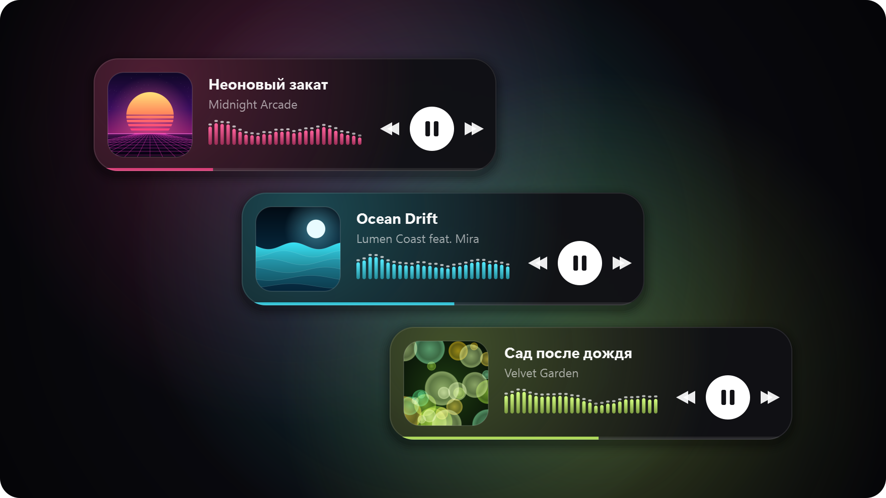
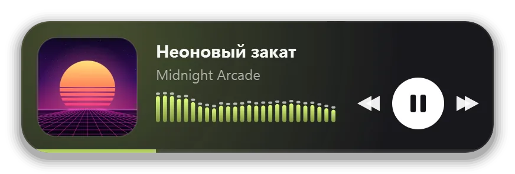

# 🎵 Taskbar Player

<p align="center">
  
</p>

Маленький красивый мини-плеер для Windows, который висит поверх всех окон и показывает,
что играет в **Яндекс Музыке**, даже в **Яндекс Браузере**, который сам не передаёт трек в Windows.

<p align="center">
  
</p>

- обложка, название и исполнитель, длинные названия едут бегущей строкой;
- кнопки ⏮ ⏯ ⏭;
- **эквалайзер**, который слушает звук компьютера и раскладывает его по частотам;
- цвет подсветки и столбиков подстраивается под обложку;
- полоска прогресса трека;
- окно можно таскать куда угодно, но **за край экрана оно не уходит**: тянется как резинка и отпружинивает обратно;
- **само появляется**, когда открыта Яндекс Музыка, и **прячется**, когда её закрыли;
- с [расширением для браузера](#расширение-для-браузера) трек обновляется, даже когда вкладка Яндекс Музыки в фоне;
- значок в трее, автозапуск вместе с Windows.

Работает и с другими плеерами, которые сообщают Windows, что сейчас играет:
приложение Яндекс Музыки, Spotify, Chrome, Edge и т. д.

---

## Что нужно

- Windows 10 или 11
- [Python 3.10+](https://www.python.org/downloads/). При установке **обязательно поставь галочку «Add python.exe to PATH»**.

## Установка

1. Скачай проект. Это можно сделать двумя способами:
   - на странице репозитория нажми зелёную кнопку **Code → Download ZIP** и распакуй архив в любую папку, например в «Документы»;
   - или через git:
     ```bash
     git clone https://github.com/egorikk58/taskbar-player.git
     ```
2. Открой эту папку, кликни по адресной строке проводника, напиши `cmd` и нажми Enter.
3. Установи зависимости:
   ```bash
   pip install -r requirements.txt
   ```
4. Запусти плеер двойным кликом по **`taskbar_player.pyw`**.
5. Поставь [расширение для браузера](#расширение-для-браузера), чтобы трек обновлялся и в фоновой вкладке.

> Плеер стартует скрытым и появится, как только ты откроешь Яндекс Музыку.
> Чтобы просто на него посмотреть, кликни по значку **♫** в трее
> (возможно, он спрятан под стрелочкой **^** возле часов).

## Расширение для браузера

Без него плеер видит трек, только пока вкладка Яндекс Музыки **активна**: Windows показывает программам
только активную вкладку браузера. С расширением название, обложка и время обновляются всегда:
в фоновой вкладке, в свёрнутом окне, на любой странице Яндекс Музыки. Кнопки плеера тоже
нажимаются прямо на странице, мгновенно.

Расширение работает только на сайтах `music.yandex.*` и отправляет данные **только на твой компьютер**
(`127.0.0.1`), в интернет ничего не уходит. Весь его код — три коротких файла в папке
[`browser-extension`](browser-extension).

**Яндекс Браузер:**
1. Открой `browser://extensions`.
2. Включи **«Режим разработчика»**.
3. Нажми **«Загрузить распакованное расширение»** и выбери папку `browser-extension` из проекта.
4. Обнови вкладку Яндекс Музыки (F5).

**Chrome / Edge:** то же самое на странице `chrome://extensions` / `edge://extensions`
(там кнопка называется «Загрузить распакованное» / «Load unpacked»).

> Не удаляй и не переноси папку проекта: браузер загружает расширение прямо из неё.

## Как пользоваться

| Действие | Что делать |
|---|---|
| Переключить трек / пауза | кнопки ⏮ ⏯ ⏭ на плеере |
| Переместить | тянуть мышкой за любое место, кроме кнопок (позиция запоминается) |
| Меню | правый клик по плееру или по значку ♫ в трее |
| Показать на пару секунд | левый клик по значку ♫ в трее |
| Автозапуск с Windows | меню → «Запускать вместе с Windows» |
| Чтобы плеер висел всегда | меню → снять галочку «Прятать, когда Яндекс Музыка закрыта» |
| Закрыть | меню → «Закрыть плеер» |

## Откуда плеер узнаёт трек

Если что-то играет сразу в нескольких местах, плеер показывает то, что играет прямо сейчас.

1. **Из Windows.** Это те же данные, что показываются в карточке рядом с ползунком громкости.
   Так работают приложение Яндекс Музыки, Spotify, Chrome, Edge и другие.
2. **Из расширения для браузера.** Яндекс Браузер не передаёт трек в Windows, а расширение
   берёт его прямо со страницы: название, исполнителей и обложку сайт сам кладёт
   в `navigator.mediaSession`, а время и кнопки берутся из блока «Плеер». Данные идут плееру
   по WebSocket на `127.0.0.1:47821`. Подключаться туда можно только расширениям браузера, обычным сайтам нельзя.
3. **Со страницы через специальные возможности Windows** (UI Automation, на них же работают
   программы экранного доступа). Это запасной вариант, если расширение не установлено.
   ⚠️ Так видна только **активная вкладка** в своём окне.

Чего не хватает на странице (например, обложки в «Моей волне»), плеер добирает из открытого API
Яндекс Музыки по id трека или альбома, авторизация не нужна.

Эквалайзер слушает звук, который выводится на устройство воспроизведения по умолчанию (WASAPI loopback).
Микрофон он не использует.

## Настройки

Константы в начале файла `taskbar_player.pyw`:

| Константа | Зачем |
|---|---|
| `PREFER` | какой плеер Windows выбирать первым, если их несколько (по умолчанию `yandex`) |
| `AUDIO_APPS` | процессы, звук из которых не даёт плееру спрятаться. По умолчанию `browser.exe`, это Яндекс Браузер. Для Chrome добавь `chrome.exe`, для Edge — `msedge.exe` |
| `HIDE_AFTER` | через сколько секунд тишины плеер прячется |
| `EDGE` | отступ от края экрана в пикселях |
| `BARS` | сколько столбиков в эквалайзере |
| `BRIDGE_PORT` | порт для расширения (`47821`). Если меняешь, поменяй его и в `browser-extension/background.js` |

Позиция окна и галочка автоскрытия хранятся в `taskbar_player.json` рядом со скриптом.

## Если что-то не так

- **Трек не обновляется, когда вкладка Яндекс Музыки в фоне.** Поставь
  [расширение](#расширение-для-браузера). Если оно уже стоит, обнови вкладку (F5): расширение
  подключается к странице при её загрузке.
- **Пишет «Ничего не играет», хотя музыка играет в браузере.** Без расширения плеер видит только
  активную вкладку: переключись на Яндекс Музыку, и через секунду трек появится.
- **Эквалайзер не двигается.** Он слушает устройство вывода по умолчанию. Если звук идёт
  на другое устройство, сделай его устройством по умолчанию в настройках звука Windows и перезапусти плеер.
- **Плеер не запустился вместе с Windows.** Автозапуск сделан через Планировщик заданий
  (задание `TaskbarPlayer`, срабатывает через 10 секунд после входа), а не через раздел реестра `Run`:
  его Windows при входе иногда пропускает целиком. Если плеер всё равно не появился,
  загляни в `taskbar_player.log` рядом со скриптом: туда пишутся запуски и все ошибки.
- **После переноса папки перестал работать автозапуск.** Сними и снова поставь галочку
  «Запускать вместе с Windows», тогда путь обновится.
- **Как удалить.** Сними галочку автозапуска (задание удалится), закрой плеер и удали папку.

## Картинки в этом README

Их рисует сам плеер. Скрипт `tools/make_screenshots.py` запускает настоящий виджет,
но вместо Яндекс Музыки подставляет выдуманные треки, нарисованные обложки и синтетический
звук, так что на картинках нет чужих обложек. Пересобрать картинки:

```bash
pip install pillow
python tools/make_screenshots.py
```

## Лицензия

[MIT](LICENSE): бери, меняй, делись.
